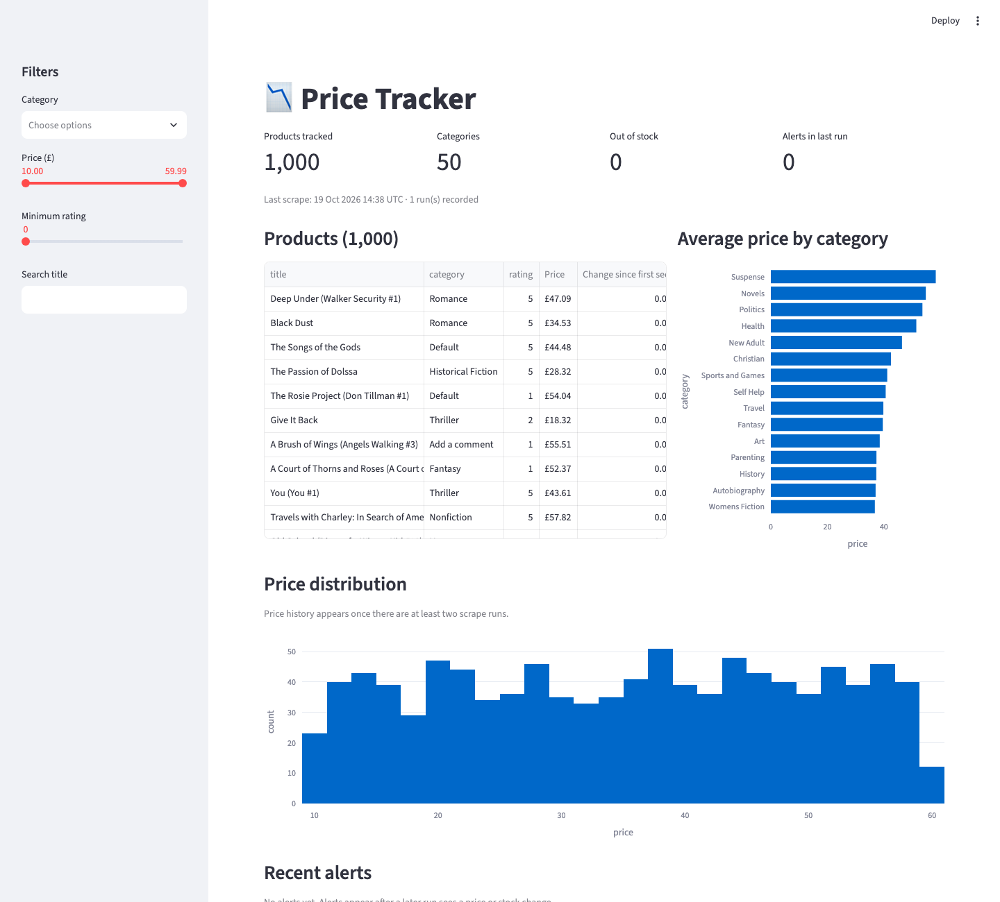

# Price Tracker: scraper → PostgreSQL → dashboard + alerts

A small, production-style price monitoring pipeline. It crawls an online catalogue on a schedule, stores every price and stock level in PostgreSQL, detects changes between runs, sends alerts to Slack or Discord and shows everything in a dashboard.

It runs against [books.toscrape.com](https://books.toscrape.com), a sandbox site made for scraping practice. The parsing and alerting logic are separated from the target site, so pointing it at a different store means writing a new `parse.py`.



## What it does

- **Crawls the whole catalogue**: follows pagination, then fetches every product page concurrently. In a real run this collected 1,000 products from 50 pages in about 60 seconds, with 0 failures.
- **Is polite and resilient**: limited concurrency, a delay between requests, retries with exponential backoff on 429/5xx and network errors. A failing page is logged and reported but never stops the run.
- **Keeps history**: every run is a row in `scrape_runs`, and every product gets a snapshot per run. You can see how a price moved over time, not just its current value.
- **Detects changes**: price drop above a configurable threshold, price increase, out of stock, back in stock. New products never trigger a false alert.
- **Sends alerts** to a Slack or Discord webhook (same payload works for both), or just logs them.
- **Dashboard** (Streamlit): KPIs, filters by category, price, rating and title, average price per category, price distribution or history, recent alerts, run log.
- **CSV export** of the full history.
- **Tests** for parsing (against saved HTML), change detection, and the crawler's retry and failure handling (mocked HTTP).

## Quick start

Requires Python 3.10+ and Docker.

```bash
docker compose up -d                      # PostgreSQL on localhost:5545
python -m venv .venv && source .venv/bin/activate
pip install -r requirements-dev.txt
cp .env.example .env                      # optional: add ALERT_WEBHOOK_URL

python -m tracker init-db
python -m tracker scrape                  # or --max-pages 2 for a quick try
streamlit run dashboard/app.py
```

Other commands:

```bash
python -m tracker schedule --every-hours 6   # run forever on an interval
python -m tracker export prices.csv          # full history to CSV
pytest                                       # 12 tests
```

For production, run `scrape` from cron or a scheduler such as Airflow or GitHub Actions instead of `schedule`.

## Configuration

All settings come from environment variables (see `.env.example`):

| Variable | Default | Meaning |
|---|---|---|
| `DATABASE_URL` | local Docker DB | PostgreSQL connection string |
| `CONCURRENCY` | 8 | Product pages fetched in parallel |
| `REQUEST_DELAY` | 0.1 | Seconds to wait after each request |
| `MAX_RETRIES` | 3 | Attempts per URL before giving up |
| `DROP_THRESHOLD_PCT` | 5 | Minimum price drop (%) that triggers an alert |
| `ALERT_WEBHOOK_URL` | empty | Slack or Discord incoming webhook |

## Data model

```
products         upc (PK), title, url, category, rating
scrape_runs      id, started_at, finished_at, products, failed, alerts
price_snapshots  (upc, run_id) -> price, stock
alerts           run_id, upc, kind, old_value, new_value
```

## Layout

```
tracker/parse.py     HTML -> Product (pure functions, tested on saved pages)
tracker/scraper.py   async crawler: pagination, concurrency, retries
tracker/alerts.py    change detection + webhook delivery
tracker/db.py        schema and queries (psycopg 3)
tracker/cli.py       init-db | scrape | schedule | export
dashboard/app.py     Streamlit dashboard
tests/               pytest + respx
```

## A note on scraping

Only scrape sites whose terms allow it, respect `robots.txt` and rate limits, and don't collect personal data. The target used here exists for practice.

## Tech

Python · httpx (async) · selectolax · PostgreSQL · psycopg 3 · Streamlit · Plotly · pytest · respx · Docker
